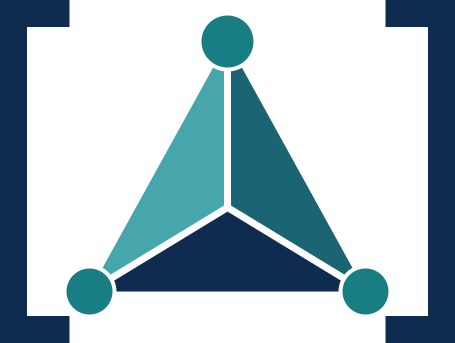

<div class="logo" align="center">
  
</div>

<h1 class="main-title" align="center">
  The Robust LMI Parser
</h1>

<div class="home-equation" align="center" markdown>
  $A(\alpha) = \sum_k A_k\,\alpha_k, \quad a_i \geq 0, \quad \sum_i \alpha_i = 1$
</div>

ROLMIP (The Robust LMI Parser) is a set of programs that works along with the [YALMIP](https://yalmip.github.io) toolbox, and it is designed to work specifically with optimization problems presenting parameter-dependent variables with parameters in the unit simplex. The variables are assumed to depend polynomially on the parameters, being the polynomials considered to be homogeneous. Such optimization problems arise, for example, on the analysis and synthesis conditions related to uncertain continuous or discrete systems, with constraints that are usually defined as Linear Matrix Inequalities (LMIs).

The main objective of ROLMIP is to provide an easy interface for the user, starting from the definition of the variables and going through a straightforward way in defining the LMIs. In addition, once all the variables and LMIs are set they can be converted into a Matlab executable file which solves the same problem but consuming much less time.

The details of ROLMIP can be found in the [User Manual](https://github.com/rolmip/rolmip/blob/main/docs/manual_rolmip.pdf) and the [online documentation](./manual).

<div class="home-buttons" markdown>

[:lucide-check: Installation](./installation){ .md-button .md-button--primary }

[<u>Explore the examples</u> :lucide-move-right:](https://github.com/rolmip/rolmip/archive/refs/tags/3.3.zip){ .md-button }

</div>

---

## Contact

If you found any bug or have any suggestion to improve the ROLMIP project, don't hesitate to open an issue, pull request or contact us at [agulhari@utfpr.edu.br](mailto:agulhari@utfpr.edu.br)

## The ROLMIP Foundation

<div class="grid cards" markdown>

-   :simple-devbox: __Cristiano M. Agulhari__

    ---

    { align=left width=165 .author }

    Core developer of ROLMIP and RolmiPy<br>
    Full professor at [UTFPR](https://www.utfpr.edu.br/)

    [:octicons-mail-16: agulhari@utfpr.edu.br](mailto:agulhari@utfpr.edu.br)<br>
    [:simple-github: /agulhari](https://github.com/agulhari)<br>
    [:simple-orcid: ORCID](https://orcid.org/0000-0001-7630-1828)

-   :simple-devbox: __Alexandre Felipe__

    ---

    { align=left width=165 .author }

    Core developer of ROLMIP<br>
    Research And Development Engineer at [T-Pro](https://info.tpro.io/)

    [:octicons-mail-16: o.alexandre.felipe@gmail.com](mailto:o.alexandre.felipe@gmail.com)<br>
    [:simple-orcid: ORCID](https://orcid.org/0000-0001-5882-2822)

-   :simple-devbox: __Ricardo C. L. F. Oliveira__

    ---

    { align=left width=165 .author }

    Core developer of ROLMIP<br>
    Full professor at [UNICAMP](https://www.unicamp.br/en/)

    [:octicons-mail-16: ricfow@dt.fee.unicamp.br](mailto:ricfow@dt.fee.unicamp.br)<br>
    [:simple-github: /ricfow](https://github.com/ricfow)<br>
    [:simple-orcid: ORCID](https://orcid.org/0000-0002-8225-7058)

-   :simple-devbox: __Pedro L. D. Peres__

    ---

    { align=left width=165 .author }

    Core developer of ROLMIP<br>
    Full professor at [UNICAMP](https://www.unicamp.br/en/)

    [:octicons-mail-16: pldperes@unicamp.br](mailto:pldperes@unicamp.br)<br>
    [:simple-orcid: ORCID](https://orcid.org/0000-0002-6371-7338)

-   :simple-devbox: __Valter J. S. Leite__

    ---

    { align=left width=165 .author }

    Core developer of ROLMIP<br>
    Full professor at [UFCIMG](https://www.cefetmg.br/home/)

    [:octicons-mail-16: valter@ieee.org](mailto:valter@ieee.org)<br>
    [:simple-github: /valter-leite](https://github.com/valter-leite)<br>
    [:simple-orcid: ORCID](https://orcid.org/0000-0002-8177-4547)

-   :simple-devbox: __Esdras B. Silva__

    ---

    { align=left width=165 .author }

    Core developer of RolmiPy and [PolyAny](https://rolmip.github.io/polyany)<br>
    PhD candidate at [UTFPR](https://www.utfpr.edu.br/)

    [:octicons-mail-16: esdras.2019@alunos.utfpr.edu.br](mailto:esdras.2019@alunos.utfpr.edu.br)<br>
    [:simple-github: /ximiraxelo](https://github.com/ximiraxelo)<br>
    [:simple-orcid: ORCID](https://orcid.org/0000-0002-9288-6376)

</div>

---

!!! info "About the Python implementation"
    The Python implementation of ROLMIP (RolmiPy) and its core ([PolyAny](https://github.com/rolmip/polyany)) is being developed by [Esdras Battosti](https://github.com/ximiraxelo) and [Cristiano Agulhari](https://github.com/agulhari).

    ??? abstract "PolyAny"
        [PolyAny](https://github.com/rolmip/polyany) is a Python package for algebraic manipulation of multivariate polynomials, which will be used to perform internal operations in RolmiPy.

---

## Citations

ROLMIP and its derivative software ([RolmiPy](./rolmipy.md) and [PolyAny](https://github.com/rolmip/polyany)) are open source, but if you use ROLMIP (and, consequently, YALMIP) in your programs, please cite us.

Citation for [YALMIP](https://yalmip.github.io/reference/lofberg2004/)

### Citation for ROLMIP

C. M. Agulhari, A. Felipe, R. C. L. F. Oliveira, and P. L. D. Peres. Algorithm 998: The Robust LMI Parser — A Toolbox to Construct LMI Conditions for Uncertain Systems. ACM Transactions on Mathematical Software, 45(3): 36:1-36:25, August 2019.

http://doi.acm.org/10.1145/3323925

**Bibtex version**

```bibtex
@article{AFOP:19,
  author = {C. M. Agulhari and A. Felipe and R. C. L. F. Oliveira and P. L. D. Peres},
  title = {Algorithm 998: {T}he {R}obust {LMI} {P}arser --- {A} toolbox to construct {LMI} conditions for uncertain systems},
  journal = {ACM Transactions on Mathematical Software},
  volume = {45},
  number = {3},
  pages = {36:1--36:25},
  year  = {2019},
  month = {August},
}
```

---

## Useful links

[SeDuMi](http://sedumi.ie.lehigh.edu/)  
[Mosek](https://www.mosek.com/)  
[R-RoMulOC - Randomized and Robust Multi-Objective Control toolbox](http://homepages.laas.fr/peaucell/software.php#romuloc)  
[SOSTools](http://www.cds.caltech.edu/sostools/)

---

## Who used ROLMIP

[Click here](https://scholar.google.com.br/scholar?cites=4276252120509952426&as_sdt=2005&sciodt=0,5&hl=en "Citations in Google Scholar") to see who already used ROLMIP.

## Acknowledgments

This work is supported by the [National Council for Scientific and Technological Development (CNPq)](https://www.gov.br/cnpq/) under grant nº 402830/2016-4.
